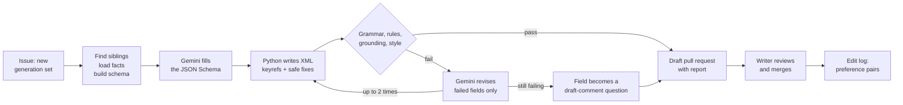

# AlignR

**Generate new DITA topics from the ones you have, and check them against the
schema before a writer sees them.**

Every new hardware generation needs a set of topics with the same structure as
the last one and new values. AlignR is an agent that drafts that set from the
existing DITA topics. Gemini fills a JSON Schema that mirrors the DITA content
model. Plain Python writes the XML, with a key reference for every value. The
topic then passes the DITA RELAX NG grammar, house rules in Schematron, a
grounding check, and Vale before it reaches a writer as a draft pull request.

The model never writes XML, never invents a value, and never merges.

**[Read the design document](https://siddharthraop.github.io/AlignR/)**

## Status

Version 0.1.0, built and live (October 2026).

- **Try it:** [the AlignR page](https://siddharthraop.github.io/AlignR/app/) shows the success metrics measured
  on real runs, drafts the held-out TPU7x set on request, and puts each draft beside the page Google published.
- **From an issue:** open a [New generation set](https://github.com/siddharthraop/AlignR/issues/new?template=new-generation-set.yml)
  issue. AlignR opens one draft pull request per topic, with gate statuses and a merge gate on open questions.
- **Docs:** [online help](https://siddharthraop.github.io/AlignR/help/) (DITA, with context-sensitive help on the
  page), the [user guide (PDF)](https://siddharthraop.github.io/AlignR/help/alignr-user-guide.pdf) built from the same
  topics, and the [developer docs](https://siddharthraop.github.io/AlignR/dev/) (MyST) with the ADRs.

The simulator and the costs in the design document are modelled. The values on the AlignR page are measured.

## The problem

Google publishes one Cloud TPU page per hardware generation. The
[v5p](https://docs.cloud.google.com/tpu/docs/v5p),
[v6e](https://docs.cloud.google.com/tpu/docs/v6e), and
[TPU7x](https://docs.cloud.google.com/tpu/docs/tpu7x) pages share one
skeleton. Because each page was written separately, the labels in that
skeleton have drifted:

| Slot | TPU v5p | TPU v6e | TPU7x |
| ---- | ------- | ------- | ----- |
| First sentence | "This document describes the ... supported configurations" | "This document describes the ... supported configurations" | "This page describes the ... available configurations" |
| Spec table | System architecture | System architecture | System architecture |
| Configurations | Configurations | Supported configurations | Supported configurations |
| VM section | VM, host and slice properties | VM types | TPU7x VM |

Values drift too. The TPU7x page gives HBM bandwidth as **7380 GBps** in its
specification table and as **approximately 7.37 TB/s** in the memory hierarchy
section below it. 7380 GBps is 7.38 TB/s. (The design document's earlier
example, 192 GiB against 192 GB, is no longer on the live page.) A value typed into prose can drift from the
table. A value stored as a DITA key can't.

The usual ways to draft the next set each miss something:

| Option | What it misses |
| ------ | -------------- |
| Copy the last generation and edit by hand | No check until the build. Labels and values drift. |
| Prompt a general chat assistant | Output isn't valid DITA. Values have no source. |
| Retrieval plus a prompt, with no gate | The XML and every value are still unchecked. |
| Fine-tune a model | Needs 12,000 to 20,000 preference pairs first, and a tuned model can still write invalid XML. |
| **AlignR: constrained generation** | **Valid DITA before review. A writer still owns the prose.** |

## What it does



For each topic in the new set, the agent does the following:

1. Reads the DITA map to find sibling topics: the same topic type, in the same
   position, for earlier generations.
1. Loads the new values from a launch facts file, and gives each fact a
   source ID and a unit.
1. Builds a JSON Schema for this topic and run. The schema's enums list only
   the keys and source IDs that exist, so Gemini can't cite a source that
   isn't there or invent a key name. The siblings fix the table layout.
1. Asks Gemini to fill the schema with
   [structured output](https://ai.google.dev/gemini-api/docs/structured-output).
1. Writes the DITA XML in Python. Each value becomes a `keyref`, any literal
   value that matches a key is replaced, and each open question becomes a
   `<draft-comment>`.
1. Runs the checks. If a check fails, Gemini revises only the failed fields,
   up to two times. A field that still fails becomes a question for a person.
1. Opens a draft pull request with a report. The agent's account can't merge.
1. On merge, logs the draft and the merged text as a preference pair, with
   the edit ratio and the cost.

### Two schema gates

| Stage | Runs on | Catches |
| ----- | ------- | ------- |
| **Gate 1: JSON Schema** | Gemini API, at generation | Missing fields, wrong types, unknown keys and sources, wrong list lengths |
| Serializer | Python | Turns literal values into key references, and questions into draft comments |
| **Gate 2: DITA grammar** | lxml with the OASIS DITA RELAX NG grammars | Any topic that isn't valid DITA |
| House rules | ISO Schematron through `lxml.isoschematron` | Spec values not in keys, table layouts that differ from siblings |
| Grounding | Python | Numbers, units, flags, and commands with no matching fact, including GiB against GB |
| Style | Vale with the Google package | Google developer documentation style guide errors |

Gate 1 shapes the output. Gate 2 proves it's DITA. The checks prove it's the
team's DITA, with true values.

### Agent tools

The agent is built with
[Agent Development Kit](https://github.com/google/adk-docs) in the design; version 0.1 runs the same ten tools as a
plain Python loop with `google-genai` ([ADR 0001](docs/adr/0001-reuse-the-knowledgeflow-pattern.md)). It has ten tools.
Only one of them calls the model.

| Tool | Type | What it does |
| ---- | ---- | ------------ |
| `find_siblings` | Deterministic | Finds topics of the same type and position in the DITA map |
| `load_facts` | Deterministic | Loads launch values with source IDs and units |
| `build_schema` | Deterministic | Maps the topic type to a JSON Schema for this run |
| `generate_topic` | Model | Gemini fills the schema with structured output |
| `serialise_dita` | Deterministic | Writes the XML, key references, and draft comments |
| `validate_grammar` | Check | Validates against the DITA RELAX NG grammar |
| `check_rules` | Check | Runs Schematron house rules and Vale |
| `check_grounding` | Check | Matches every value, unit, flag, and command to a source |
| `open_pr` | Deterministic | Opens a draft pull request with the report |
| `log_pair` | Deterministic | Logs the draft and merged text as a preference pair |

## Sample output

The value in the table and the value in the prose come from one key. A real
conflict in the sources becomes a question, not a guess.

```xml
<reference id="tpu7x-system-architecture" xml:lang="en-US">
  <title>TPU7x system architecture</title>
  <shortdesc>Each TPU7x chip contains two TensorCores and four SparseCores.</shortdesc>
  <refbody>
    <properties id="specs">
      <property><proptype>HBM capacity per chip</proptype>
        <propvalue><ph keyref="tpu7x-hbm-capacity"/></propvalue></property>
      <!-- more rows, same layout as the v6e sibling -->
    </properties>
    <section id="memory"><title>Memory hierarchy</title>
      <p>Each chip has <ph keyref="tpu7x-hbm-capacity"/> of high-bandwidth memory (HBM).</p>
      <draft-comment author="alignr" disposition="open">
        For the engineer: S1 gives HBM bandwidth as 7380 GBps; S2 gives approximately 7.37 TB/s. Which is correct?
      </draft-comment>
    </section>
  </refbody>
</reference>
```

DITA processors don't render
[`<draft-comment>`](https://dita-lang.org/dita/langref/base/draft-comment) by
default, and a release build can fail on any open draft comment. A question
can't ship by accident.

## When fine-tuning pays

The first version of AlignR aligned a model by fine-tuning it on 12,000 to
20,000 preference pairs. This version keeps the preference pair format and
drops the training. Pairs collect themselves from normal review: the agent's
draft is *rejected*, and the writer's merged text is *chosen*.

Repeated edits become Schematron rules, sibling examples, or prompt notes
first, because a rule costs nothing to run. Tuning is a decision that the edit
log makes with a fixed rule. AlignR proposes tuning only when all three of the
following are true:

1. The log holds at least 12,000 accepted pairs for one topic type.
1. The edit ratio for that topic type has stopped falling for three launches
   in a row, after new rules and examples.
1. A replay of held-out pairs shows that a tuned model saves more writer hours
   than its training and serving cost.

Current pricing explains why the rule is strict. The
[Agent Platform pricing page](https://cloud.google.com/gemini-enterprise-agent-platform/generative-ai/pricing)
lists Gemini 3.5 Flash as the newest Flash model with supervised fine-tuning,
and a tuned endpoint for Gemini 3 and later costs 1.5 times its base model.
Here is the modeled cost of one draft attempt:

| Path | Modeled tokens | Cost per attempt |
| ---- | -------------- | ---------------: |
| Gemini 3.8 Flash, introductory price (to December 31, 2026) | 12k in, 2k out | $0.017 |
| Gemini 3.8 Flash, standard price (from January 1, 2027) | 12k in, 2k out | $0.033 |
| Tuned Gemini 3.5 Flash endpoint | 3k in, 2k out | $0.034 |

The tuned path also needs about $1,800 of training and an annotation effort
before the first draft. Tuning doesn't make a draft cheaper, so it can pay only
through writer time. The log measures writer time, so the log decides.

## How you know it works

AlignR holds out TPU7x. It drafts the TPU7x topics from the v5p and v6e
topics and the TPU7x values, and then compares each draft with the page that
Google published.

| Metric | MVP target |
| ------ | ---------- |
| Drafts that reach a writer and fail the DITA grammar | 0 |
| Values with a key or a source | 100% |
| Edit ratio on topics that have a sibling | Under 40% |
| Time from issue to draft pull requests for the set | Under 15 minutes |
| Open questions at merge | 0 |
| Runs with logged cost | 100% |

**Known limits.** AlignR drafts what has a sibling. A concept that's new in a
generation, such as the TPU7x dual-chiplet design, gets a stub with questions
instead of prose. lxml checks the grammar but doesn't apply the default
attribute values that DITA processing needs, so DITA-OT still builds every
topic in CI.

## Technology

The MVP runs on Google Cloud and free or open-source tools.

| Part | Technology | Free tier or license |
| ---- | ---------- | -------------------- |
| Agent framework | [Agent Development Kit](https://github.com/google/adk-docs) | Apache 2.0 |
| Model | Gemini 3.8 Flash (`gemini-3.8-flash`) with structured output | [Gemini API free tier](https://ai.google.dev/gemini-api/docs/pricing) |
| Grammar gate | [OASIS DITA RELAX NG grammars](https://dita-lang.org/1.3/dita/archspec/base/recognizedconstraintmechanisms), validated with [lxml](https://lxml.de/validation.html) | Open standard; open source |
| House rules | [`lxml.isoschematron`](https://lxml.de/apidoc/lxml.isoschematron.html) | Open source |
| Style | [Vale](https://vale.sh/) with the [Google package](https://vale.sh/hub/google/) | Package licensed under CC BY 4.0 |
| Build check | DITA-OT 4.4 | Apache 2.0 |
| Trigger and review gate | GitHub Actions and [protected branches](https://docs.github.com/en/repositories/configuring-branches-and-merges-in-your-repository/managing-protected-branches/about-protected-branches) | [Free for public repositories](https://docs.github.com/en/billing/concepts/product-billing/github-actions) |
| Agent runtime | Cloud Run job | [180,000 vCPU-seconds a month](https://cloud.google.com/run/pricing) |
| Edit log | BigQuery | [10 GiB storage and 1 TiB of queries a month](https://cloud.google.com/bigquery/pricing) |

**Data handling.** The sample content is public, so the Gemini API free tier
is acceptable for the MVP. Content sent on the free tier is used to improve
Google products, so unreleased launch values need the paid tier
([Gemini API pricing](https://ai.google.dev/gemini-api/docs/pricing)).

## Run it locally

```sh
git clone --recurse-submodules https://github.com/siddharthraop/AlignR.git
cd AlignR
pip install -e '.[api,test]'
corpus/tools/fetch_grammar.sh
python -m pytest -q
alignr draft --model baseline --out out/baseline     # no key needed; GOOGLE_API_KEY and --model gemini for Gemini
```

See the [developer docs](https://siddharthraop.github.io/AlignR/dev/) for the API, the page and the DITA-OT build.

## Repository contents

| Path | Contents |
| ---- | -------- |
| `alignr/` | The engine: siblings, facts, schema, model, serialiser, checks, loop, comparison, CLI |
| `api/` | FastAPI service on Cloud Run |
| `app/` | The AlignR page |
| `facts/tpu7x.yaml` | The TPU7x launch facts, each value with a source ID |
| `corpus/` | [dita-corpus](https://github.com/siddharthraop/dita-corpus), the shared DITA source (submodule) |
| `help/` | User help and user guide in DITA, and the context-sensitive help builder |
| `docs/` | Developer docs and ADRs in MyST |
| `runs/` | Run records from the Git path, read by the page |
| `scripts/open_prs.py` | Draft pull requests, statuses and the run record |
| `tests/` | Tests per topic type, with a scripted model |
| `index.html` | The design document |

## Sample content and attribution

The sample content is adapted from the Google Cloud TPU documentation:
[TPU7x (Ironwood)](https://docs.cloud.google.com/tpu/docs/tpu7x),
[TPU v6e](https://docs.cloud.google.com/tpu/docs/v6e), and
[TPU v5p](https://docs.cloud.google.com/tpu/docs/v5p). Google publishes this
content under the
[Creative Commons Attribution 4.0 License](https://creativecommons.org/licenses/by/4.0/),
as described in the
[Google Developers Site Policies](https://developers.google.com/site-policies).
The adapted content is modified from the original. The DITA keys, launch facts
file, and generated topics are written for this design and aren't part of
Google's published pages.

The sample runs, issue and pull request numbers, costs, and scorecard values
are written for this design and aren't Google records or measured results.

This is a portfolio project. Google hasn't engaged, sponsored, or endorsed this
work. Stakeholders in the design document are job roles, not real people, and
the readers are fictional.

## Part of a series

This project is the fourth in a series of design documents. Each one solves one
economic problem in documentation, and each builds on the same sample content.

1.  [MANIFEST](https://siddharthraop.github.io/Manifest/): migrate DITA XML to
    docs as code and prove that no content was lost.
1.  [The Autonomous Author](https://siddharthraop.github.io/The-Autonomous-Author/):
    run the docs loop at the pace of the code loop, with a first draft on every
    merge.
1.  [KnowledgeFlow](https://siddharthraop.github.io/KnowledgeFlow/): answer
    questions across documentation silos, from the links writers already
    maintain.
1.  **AlignR**: generate new DITA topics from the ones you have, and check them
    against the schema before a writer sees them.

AlignR version 0.1 replaces an earlier design of the same name (version 1.0.0),
which aligned an open-weight model with RLHF and DPO for regulated industries.
That version is kept under the `v1.0.0` tag. This version keeps its preference
pair format and replaces training with schema-constrained generation.

## Contact

Siddharth Rao. To ask a question or suggest a change,
[open an issue](https://github.com/siddharthraop/AlignR/issues).

## License

The design document, diagrams, and code in this repository are licensed under
the [MIT License](LICENSE). Adapted Google content remains under the Creative
Commons Attribution 4.0 License.
